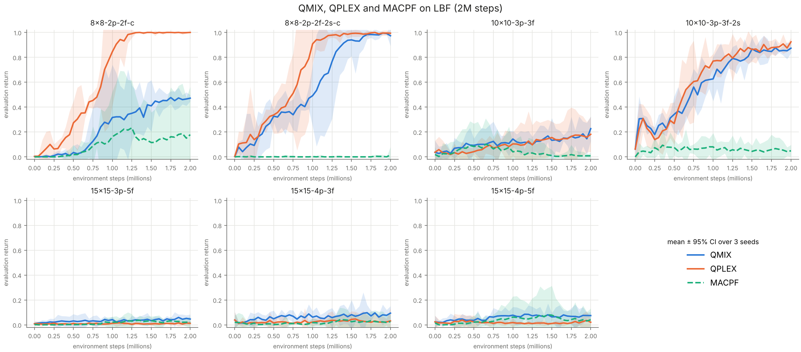
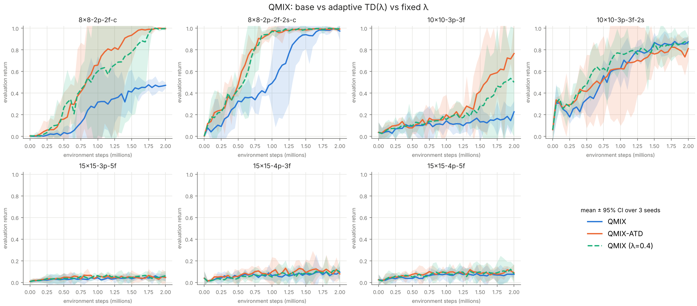
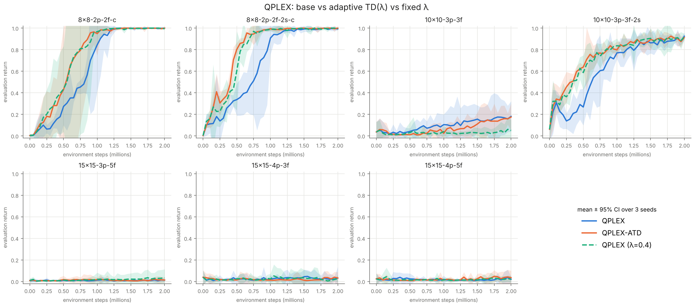
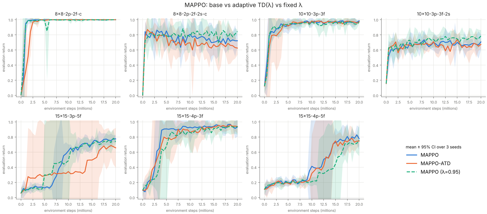
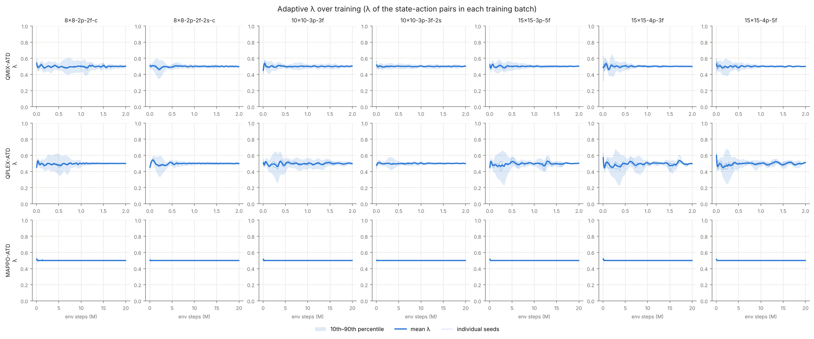
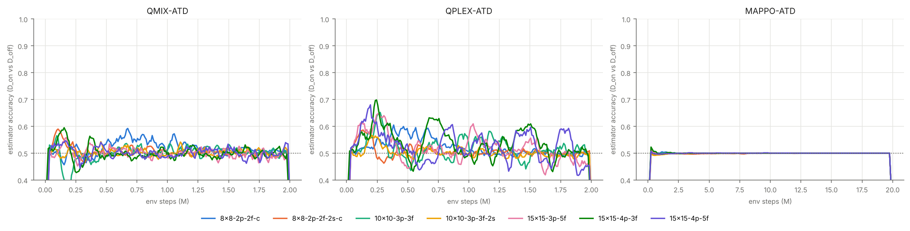

# `lbf_bench`: QMIX, QPLEX, MAPPO, MACPF and adaptive TD(λ) on Level-Based Foraging

The study runs four algorithms and the adaptive TD(λ) (ATD) variants of three of them on the seven
Level-Based Foraging (LBF) tasks of

> Papoudakis, Christianos, Schäfer & Albrecht, *Benchmarking Multi-Agent Deep Reinforcement Learning
> Algorithms in Cooperative Tasks*, NeurIPS 2021 Datasets & Benchmarks (arXiv:2006.07869v4),

with the environment from [semitable/lb-foraging](https://github.com/semitable/lb-foraging)
(`pip install lbforaging`, v2.0.0, with lbforaging v1's item-level rule restored; see below).

| name | algorithm | source of its hyper-parameters |
|---|---|---|
| `qmix` | QMIX (Rashid et al. 2018) | benchmark paper, appendix I table 28 (LBF, parameter sharing) |
| `qplex` | QPLEX (Wang et al. 2021) | mixer: QPLEX paper, table 2; training: QMIX's LBF settings (see below) |
| `mappo` | MAPPO (Yu et al. 2022) | benchmark paper, appendix I table 24 (LBF, parameter sharing) |
| `macpf` | MACPF (Wang, Ye & Lu 2023) | MACPF paper, appendix C (not in the benchmark) |
| `qmix_atd`, `qplex_atd`, `mappo_atd` | the same with ATD(λ) (Deng, Wang & Zhang 2026) | base learner + ATD paper table 3 / sec. 4 |
| `qmix_l0.4`, `qplex_l0.4`, `mappo_l0.95` | fixed-λ controls | see "Fixed-λ controls" |

```bash
pip install torch numpy matplotlib lbforaging
python -m lbf_bench.run --algo qmix_atd --task 10x10-3p-3f --seed 0 --out results/lbf   # one run
python -m lbf_bench.sweep --seeds 0 1 2 --workers 4 --out results/lbf                   # the whole study
python -m lbf_bench.analysis --root results/lbf                                          # tables + figures
pytest -q tests/test_lbf_bench.py
```

## Environment and tasks

The seven tasks of the benchmark (sec. 3.4, table 3), each with a 50-step time limit (appendix A,
`env_args.time_limit=50`). Agent levels are 1–2. `-2s` means each agent sees only a 5×5 window (sight 2).
`-c` means every item needs all agents to load it at once.

`8x8-2p-2f-c`, `8x8-2p-2f-2s-c`, `10x10-3p-3f`, `10x10-3p-3f-2s`, `15x15-3p-5f`, `15x15-4p-3f`, `15x15-4p-5f`

* **Reward.** All learners receive the *common* reward, the sum of the agents' rewards (EPyMARL's
  `common_reward=True`). lbforaging normalises rewards so an episode in which every item is collected
  returns 1.
* **Observations.** Each agent gets its lbforaging feature vector (x, y, level per item and per agent;
  -1, -1, 0 when an entity is not visible) plus a one-hot agent id. The global state used by the mixers,
  centralised critics and the ATD estimator is all agents' observations concatenated, as in EPyMARL's
  wrapper.
* **Item levels as in lbforaging v1.** The benchmark used lbforaging 1.0.x (task ids `Foraging-…-v1`).
  Let S be the sum of the three lowest agent levels. v1 draws a non-cooperative item's level from 1…S−1
  (`randint(1, S)`, exclusive upper bound); v2.0.0 draws it from 1…S. With three agents, v2 raises the
  share of items that only *all* agents together can load from about 2% to about 25% (and the share that
  needs more than one agent from 45% to 58%). `env.V1ItemLevels` restores v1's rule; everything else is
  lbforaging 2.0.0's code. Cooperative items are S in both versions, so the two `-c` tasks are unaffected.
  This was found after seed 0 had run with v2's rule: MAPPO and QMIX were far below the paper on the
  non-cooperative tasks (e.g. MAPPO 0.12 vs. 0.77 on `15x15-3p-5f`, QMIX 0.12 vs. 0.84 on `10x10-3p-3f`)
  and in line with it on the cooperative ones. Those 50 runs are kept in `results/lbf_v2items/` and are
  not part of the study.
* **Termination vs time limit.** lbforaging reports both as `done`. Here they are separated: an episode
  *terminates* when every item has been collected and is *truncated* at the time limit. Value targets
  bootstrap on truncation and not on termination.

## Protocol (benchmark paper, sec. 4.1 and 4.3)

* **Budget.** Off-policy algorithms (QMIX, QPLEX, MACPF) train for 2M environment steps, on-policy ones
  (MAPPO) for 20M.
* **Evaluation.** 41 evaluations at equal intervals (t = 0 included), each the mean return of 100 episodes.
  Value-based agents evaluate ε-greedily with their evaluation ε. MAPPO samples its policy, as the paper
  does. MACPF acts greedily with its independent policies, as in its paper's code.
* **Seeds.** 0, 1, 2. The paper used five. Three keep the whole study at about 2.5 days on 4 CPU cores.
* **Metrics.**
  * *Maximum return*: the evaluation step whose mean over seeds is highest, reported as mean ± 95% CI
    over seeds at that step.
  * *Average return*: the mean over all 41 evaluations.
  * The paper re-evaluates saved models at the best step; here that step's own 100-episode evaluation is
    used.

## Hyper-parameters

| | QMIX | QPLEX | MAPPO | MACPF |
|---|---|---|---|---|
| network | FC 64 → GRU 64 → FC | FC 64 → GRU 64 → FC | FC 128 → FC 128 → FC (no RNN) | FC 64 → GRU 64 → FC, + correction nets 64 (ELU) |
| optimiser, lr | Adam 3e-4 | Adam 3e-4 | Adam 3e-4 (actor and critic) | RMSprop 5e-4 |
| reward standardisation | yes | yes | no | no |
| exploration | ε 1 → 0.05 over 200k steps | ε 1 → 0.05 over 200k steps | sample the policy, entropy 0.001 | dependent policy mixed with uniform, ε 1 → 0.05 over 50k |
| evaluation | ε = 0.05 | ε = 0.05 | sample | greedy (independent policies) |
| target network | soft, τ = 0.01 per update | soft, τ = 0.01 per update | critic soft, τ = 0.01 | hard, every 200 episodes |
| data | 5000-episode replay, 32 episodes per update, 1 update per episode | same as QMIX | 10 parallel episodes per update, 4 epochs, clip 0.2 | 5000-episode replay, 32 episodes, 1 update per episode |
| targets | 1-step Double-Q | 1-step Double-Q | critic: 5-step returns; actor: 5-step advantage | soft TD(λ = 0.8), α 0.5 → 0.05 over 200k steps |
| mixer | QMIX hypernetworks (embed 32, hypernet 64, 2 layers) | duplex dueling; 1-layer w, b, λ, φ, υ; 4 heads; stop-gradient on Aᵢ | – | hypernetwork mixer without non-linearity (embed 64) |
| parameter sharing | yes (+ agent id) | yes | yes | yes |

Gradient-norm clip 10 and γ = 0.99 everywhere.

**Where each value comes from:**

1. **QMIX and MAPPO: the benchmark paper.** The tuned LBF values are in appendix I, table 28 (QMIX) and
   table 24 (MAPPO), with parameter sharing; the earlier arXiv versions only give ranges. Details neither
   version states come from EPyMARL, the authors' code: episode batches, Double-Q, MSE losses, n-step critic
   targets from a target critic, PPO epochs over the whole batch without minibatches, and no advantage
   normalisation.
2. **QPLEX: mixer from its own paper, training settings from QMIX.** The benchmark doesn't include QPLEX.
   The mixer follows QPLEX's table 2 (StarCraft column). The transformation is eq. 7's `wᵢ(s)Qᵢ + bᵢ(s)`; the
   paper mentions Qatten's transformation for SMAC but leaves its details to the code. QPLEX's own training
   settings (appendix B.2: PyMARL defaults, ε 1 → 0.05 over 50k steps, RMSprop lr 5e-4, two updates per
   episode, hard target every 200 episodes) never got above a return of 0 on LBF: 0.00 after 700k steps on
   `8x8-2p-2f-c`, where QMIX had reached 0.42 by 1M. Its greedy policy locked in before it had found food. On
   the user's decision QPLEX therefore uses the benchmark's LBF settings for QMIX, so QMIX and QPLEX differ
   only in the mixer.
3. **MACPF: its own paper.** Appendix C.2 (SMAC) gives the learning rate, network sizes, target period and
   α schedule; appendices C.1 and E give the hypernetwork mixer. Values not in the paper come from the
   authors' PyMARL code (`dfop.yaml`): RMSprop, TD(λ) 0.8, batch and buffer sizes, ε-mixture exploration and
   the last action as an input.
4. **ATD(λ): its own paper (sec. 4.1–4.3, appendix G, algorithm 1).**
   * The estimator ω is MLP(64) → GRU(64) → linear over [state, one-hot joint action], and λ = sigmoid(ω).
   * It is trained with BCE (eq. 8), D_on labelled 1 and D_off labelled 0, using Adam at lr 1e-3.
   * D_off is 50× larger than D_on, the paper's best ratio.
   * One estimator step on 32 episodes from each buffer per target-update period. Each transition's λ is
     cached and the cache is cleared at the same period. For QMIX, whose target is soft-updated, the period
     is 200 episodes, the PyMARL hard-update interval the ATD paper used.
   * In QMIX- and QPLEX-ATD, D_on is the newest 100 episodes of the replay and D_off the rest of it.
   * The TD targets are the λ-returns of eq. 10.
   * In MAPPO-ATD, D_on is the current batch and D_off the previous 50 batches. The critic regresses on
     ATD λ-returns and the actor's advantages are unchanged (sec. 4.3). The estimator takes one step per
     PPO update, since its target critic is updated at every update.
   * Every ATD variant otherwise keeps its base learner's settings, so ATD is the only difference.

### Fixed-λ controls

Base QMIX, QPLEX and MAPPO use 1-step or 5-step targets, so ATD changes two things at once: it uses
λ-returns at all, and it picks λ per state-action pair. The controls use λ-returns with a *fixed* λ:

* **λ = 0.4 for QMIX and QPLEX**: the `td_lambda` of the ATD paper's own QMIX and QPLEX baselines (table 3).
* **critic λ = 0.95 for MAPPO**: MAPPO's GAE λ (Yu et al. 2022).

## Grid search

None. Every value comes from one of the papers above.

## Results (3 seeds, all 210 runs)

All tables are in [`results/lbf/summary.md`](../results/lbf/summary.md) and the figures in
[`results/lbf/figures/`](../results/lbf/figures/). Regenerate them with
`python -m lbf_bench.analysis --root results/lbf`. Values are mean ± 95% CI over seeds 0–2; **bold** is
the best in the row.

### Main algorithms: maximum returns, compared with the benchmark paper

| task | QMIX | QMIX (paper) | QPLEX | MACPF | MAPPO | MAPPO (paper) |
|---|---|---|---|---|---|---|
| 8x8-2p-2f-c | 0.48 ± 0.05 | 0.96 ± 0.07 | **1.00 ± 0.00** | 0.23 ± 0.38 | **1.00 ± 0.00** | 1.00 ± 0.00 |
| 8x8-2p-2f-2s-c | 0.99 ± 0.01 | 1.00 ± 0.00 | **1.00 ± 0.00** | 0.01 ± 0.06 | 0.86 ± 0.12 | 0.85 ± 0.06 |
| 10x10-3p-3f | 0.23 ± 0.10 | 0.84 ± 0.08 | 0.18 ± 0.14 | 0.10 ± 0.21 | **0.99 ± 0.02** | 0.99 ± 0.01 |
| 10x10-3p-3f-2s | 0.88 ± 0.06 | 0.90 ± 0.01 | **0.92 ± 0.03** | 0.09 ± 0.16 | 0.74 ± 0.14 | 0.72 ± 0.03 |
| 15x15-3p-5f | 0.06 ± 0.02 | 0.09 ± 0.04 | 0.02 ± 0.02 | 0.04 ± 0.04 | **0.78 ± 0.05** | 0.77 ± 0.02 |
| 15x15-4p-3f | 0.10 ± 0.06 | 0.15 ± 0.06 | 0.05 ± 0.06 | 0.04 ± 0.10 | **0.97 ± 0.01** | 0.96 ± 0.02 |
| 15x15-4p-5f | 0.08 ± 0.03 | 0.25 ± 0.09 | 0.04 ± 0.05 | 0.08 ± 0.22 | **0.83 ± 0.13** | 0.70 ± 0.25 |

The paper columns are from its table 3 (LBF, parameter sharing, 5 seeds). Bold covers this study's
columns only.



* **MAPPO reproduces the paper.** Its confidence intervals overlap the paper's on all seven tasks; on
  `15x15-4p-5f` it is somewhat higher (0.83 vs. 0.70 ± 0.25).
* **QMIX matches the paper on four tasks and is lower on three.** It matches on `8x8-2p-2f-2s-c`,
  `10x10-3p-3f-2s`, `15x15-3p-5f` and `15x15-4p-3f`. It is lower on:
  * `8x8-2p-2f-c`: 0.48 vs. 0.96. All three seeds plateau near 0.5, i.e. one of the two items, so this
    is not seed noise.
  * `10x10-3p-3f`: 0.23 vs. 0.84.
  * `15x15-4p-5f`: 0.08 vs. 0.25.

  The hyper-parameters are the paper's table 28. The cause of the gap was not found. The same QMIX
  with λ-returns (λ = 0.4, or ATD) reaches 1.00 and 0.54–0.77 on the first two of these tasks, which
  points at the 1-step target propagating the sparse reward too slowly. The paper's code may differ from
  this implementation in a detail neither the paper nor EPyMARL's defaults pin down. The paper's own
  QMIX result on `8x8-2p-2f-c` is marked as high-variance.
* **QPLEX is the best value-based method on three of the four small tasks** (1.00, 1.00 and 0.92).
  On `10x10-3p-3f` both fail: QPLEX 0.18, QMIX 0.23. Like QMIX, it fails on the three 15×15 tasks. It uses QMIX's LBF
  training settings, so the difference is the mixer alone. The benchmark has no QPLEX numbers to compare
  with.
* **MACPF does not learn LBF** with its paper's (SMAC) hyper-parameters; its best task is 0.23 ± 0.38
  on `8x8-2p-2f-c`. It was not tuned (no grid search), so this says nothing about MACPF with LBF-tuned
  settings.

### Adaptive TD(λ) vs fixed λ: maximum returns

| task | QMIX | QMIX-ATD | QMIX λ=0.4 | QPLEX | QPLEX-ATD | QPLEX λ=0.4 | MAPPO | MAPPO-ATD | MAPPO λ=0.95 |
|---|---|---|---|---|---|---|---|---|---|
| 8x8-2p-2f-c | 0.48 ± 0.05 | **1.00 ± 0.00** | **1.00 ± 0.00** | **1.00 ± 0.00** | **1.00 ± 0.00** | **1.00 ± 0.00** | **1.00 ± 0.00** | **1.00 ± 0.00** | **1.00 ± 0.00** |
| 8x8-2p-2f-2s-c | 0.99 ± 0.01 | 1.00 ± 0.01 | **1.00 ± 0.00** | **1.00 ± 0.00** | **1.00 ± 0.00** | **1.00 ± 0.00** | 0.86 ± 0.12 | 0.87 ± 0.16 | **0.88 ± 0.04** |
| 10x10-3p-3f | 0.23 ± 0.10 | **0.77 ± 0.30** | 0.54 ± 0.48 | **0.18 ± 0.14** | 0.17 ± 0.13 | 0.06 ± 0.11 | **0.99 ± 0.02** | 0.98 ± 0.02 | 0.98 ± 0.02 |
| 10x10-3p-3f-2s | **0.88 ± 0.06** | 0.82 ± 0.09 | 0.87 ± 0.11 | 0.92 ± 0.03 | **0.93 ± 0.02** | 0.92 ± 0.03 | 0.74 ± 0.14 | 0.74 ± 0.07 | **0.78 ± 0.08** |
| 15x15-3p-5f | 0.06 ± 0.02 | 0.07 ± 0.03 | **0.07 ± 0.03** | 0.02 ± 0.02 | 0.02 ± 0.04 | **0.03 ± 0.08** | 0.78 ± 0.05 | 0.69 ± 0.16 | **0.78 ± 0.12** |
| 15x15-4p-3f | 0.10 ± 0.06 | **0.13 ± 0.02** | 0.11 ± 0.02 | 0.05 ± 0.06 | 0.04 ± 0.05 | **0.05 ± 0.11** | **0.97 ± 0.01** | 0.96 ± 0.06 | 0.94 ± 0.11 |
| 15x15-4p-5f | 0.08 ± 0.03 | 0.12 ± 0.08 | **0.12 ± 0.07** | 0.04 ± 0.05 | **0.05 ± 0.06** | 0.04 ± 0.08 | **0.83 ± 0.13** | 0.78 ± 0.15 | 0.76 ± 0.21 |

Bold is the best within each base algorithm's three columns. Average returns are in `summary.md`.
There, QMIX-ATD and QMIX λ = 0.4 are well above QMIX on the two `8x8` tasks and `10x10-3p-3f` (e.g.
0.57 and 0.52 vs. 0.24 on `8x8-2p-2f-c`). QPLEX-ATD and QPLEX λ = 0.4 are above QPLEX on `8x8-2p-2f-2s-c`
and `10x10-3p-3f-2s` (0.81 / 0.79 vs. 0.67 and 0.73 / 0.72 vs. 0.62).

| QMIX | QPLEX | MAPPO |
|---|---|---|
|  |  |  |

### λ over time





| task | QMIX-ATD early / mid / late | QPLEX-ATD early / mid / late | MAPPO-ATD early / mid / late |
|---|---|---|---|
| all seven tasks | 0.50 / 0.50 / 0.50 | 0.48–0.50 / 0.49–0.50 / 0.49–0.50 | 0.50 / 0.50 / 0.50 |

**The adaptive λ stays at about 0.5 on every task and algorithm.** The estimator's job is to tell
D_on from D_off, and its accuracy on that hovers at chance:
* QMIX-ATD: about 0.5, with brief excursions to 0.6.
* QPLEX-ATD: up to 0.7 early in training, then back to about 0.5.
* MAPPO-ATD: exactly 0.5 after the first few hundred thousand steps. The estimator's output collapses
  to a constant, so λ is 0.500 everywhere.

ATD sets λ = sigmoid(ω), so a chance-level estimator gives λ ≈ 0.5.

**What this means for the comparison.** In practice ATD here is a λ-return learner with λ ≈ 0.5, and it
behaves like the fixed-λ controls:
* **QMIX and QPLEX.** The ATD gains over 1-step QMIX/QPLEX are matched by the fixed λ = 0.4 controls,
  within overlapping CIs on every task. The benefit comes from using λ-returns at all, not from adapting
  λ per state-action pair.
* **MAPPO.** The critic already uses 5-step returns, and ATD, λ = 0.95 and the base are statistically
  indistinguishable on all tasks. MAPPO-ATD is slower on `15x15-3p-5f`; there one seed lags for most of
  training (mean 0.69 vs. 0.78, CIs overlap).

Whether the estimator separates D_on from D_off better on other domains, or with settings other than the
ATD paper's table 3 values used here, was not tested.

### Deviations and caveats

* 3 seeds instead of the paper's 5, so the CIs are wide. Several differences above are within noise.
* lbforaging v2.0.0 with v1's item-level rule restored (see "Item levels as in lbforaging v1").
* QPLEX uses QMIX's LBF training settings (its own settings never learned on LBF; see above).
* The maximum return is the best step's own 100-episode evaluation. The paper re-evaluates saved models.
* No hyper-parameter search for any algorithm.
* Wall time per run on one CPU core:

  | algorithm | minutes per run |
  |---|---|
  | QMIX | 41 |
  | QPLEX | 44 |
  | ATD variants of QMIX and QPLEX | 48–49 |
  | λ-controls of QMIX and QPLEX | 44–46 |
  | MAPPO | 85–87 |
  | MAPPO-ATD | 103 |
  | MACPF | 119 |
